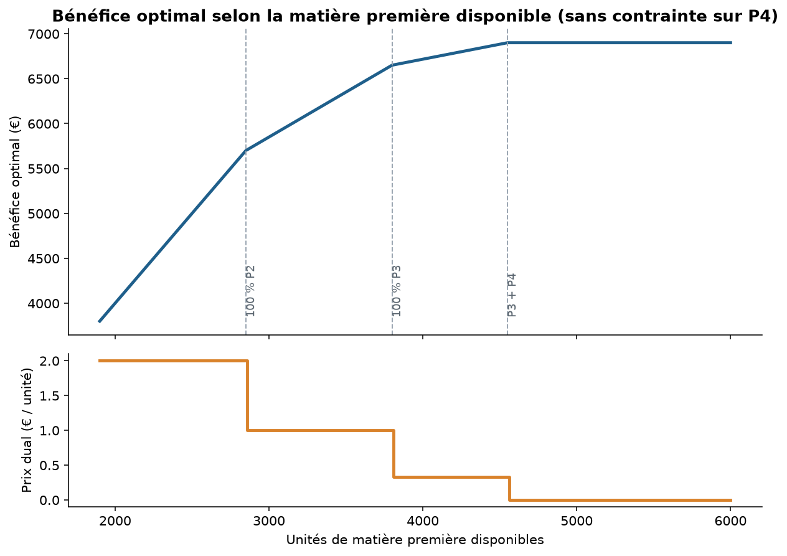
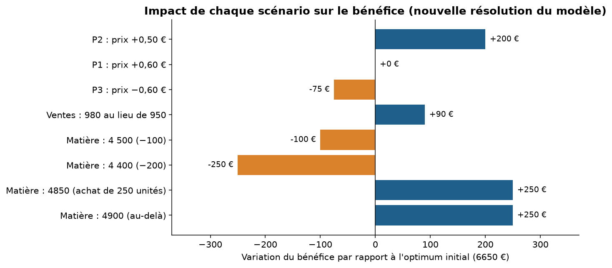
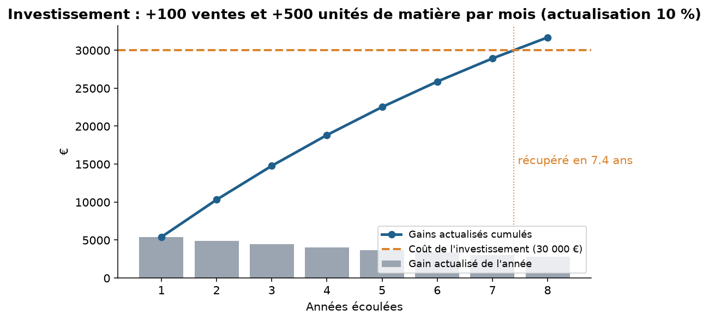

# Optimisation de la production : programmation linéaire et analyse de sensibilité

Projet de **recherche opérationnelle** (Polytech Lille, ISIA 4) : une entreprise fabrique quatre produits à partir d'une seule matière première et cherche le plan de production qui **maximise son bénéfice**. Au-delà de la solution optimale, le projet utilise la **dualité** et l'**analyse de sensibilité** pour répondre à des questions de gestion : faut-il acheter de la matière première, à quel prix, faut-il changer un prix de vente, recourir à l'intérim, investir ?

Le modèle avait été résolu avec **LINGO** ; ce dépôt le reproduit en **Python** avec le solveur open source **HiGHS** et retrouve tous les résultats (solution, prix duaux, plages de validité).



## Le modèle

| | P1 | P2 | P3 | P4 | Limite |
|---|---|---|---|---|---|
| Bénéfice unitaire (€) | 4 | 6 | 7 | 8 | à maximiser |
| Matière première (unités) | 2 | 3 | 4 | 7 | ≤ 4 600 |
| Heures de travail | 3 | 4 | 5 | 6 | ≤ 5 000 |
| Ventes totales | 1 | 1 | 1 | 1 | = 950 |
| Demande du produit 4 | | | | 1 | ≥ 400 |

```
max  4 x1 + 6 x2 + 7 x3 + 8 x4
s.c. x1 + x2 + x3 + x4 = 950
     x4 ≥ 400
     2 x1 + 3 x2 + 4 x3 + 7 x4 ≤ 4600
     3 x1 + 4 x2 + 5 x3 + 6 x4 ≤ 5000
     x1, x2, x3, x4 ≥ 0
```

## Solution optimale

**Bénéfice maximal : 6 650 €** avec P1 = 0, P2 = 400, P3 = 150, P4 = 400. Le programme dual, résolu séparément, donne la même valeur (dualité forte).

| Contrainte | Marge | Prix dual | Plage de validité du second membre |
|---|---|---|---|
| Ventes totales (= 950) | 0 | 3 € | 850 à 1 000 |
| Demande P4 (≥ 400) | 0 | −2 € | 275 à 437,5 |
| **Matière première (≤ 4 600)** | **0 (saturée)** | **1 €** | **4 450 à 4 850** |
| Heures (≤ 5 000) | 250 h libres | 0 € | – |

- La **matière première est le facteur limitant** ; les heures de travail ne le sont pas (250 heures inutilisées).
- Le produit 1 n'est pas fabriqué : son **coût réduit** est de 1 €, il ne devient rentable que si son bénéfice unitaire augmente d'au moins 1 €.

## Questions d'aide à la décision

Chaque prédiction issue de l'analyse de sensibilité est confirmée par une nouvelle résolution complète du modèle.



| Question | Raisonnement | Résultat |
|---|---|---|
| Prix de P2 +0,50 € | P2 en base, hausse dans la plage : +0,50 × 400 | **6 850 €**, plan inchangé |
| Prix de P1 +0,60 € | coût réduit 1 € > 0,60 € | **6 650 €**, P1 toujours non produit |
| Prix de P3 −0,60 € | 6,40 € sort de la plage [6,50 ; 8] : la base change | **6 575 €**, P3 abandonné (P2 = 512,5 ; P4 = 437,5) |
| 980 ventes au lieu de 950 | prix dual 3 € × 30 | **6 740 €** |
| Matière : 4 500 (−100) | dans la plage : −100 × 1 € | **6 550 €** |
| Matière : 4 400 (−200) | hors plage (< 4 450) : la perte dépasse 200 € | **6 400 €** (P1 = 50 ; P2 = 500 ; P4 = 400) |
| Achat de matière | prix dual 1 €, valable jusqu'à +250 unités | payer au plus **1 € par unité**, pour **250 unités** au maximum |
| Intérim | heures non saturées, prix dual nul | intéressant seulement si moins cher que le coût interne (6 €/h), honoraires compris |

**Analyse paramétrique (sans la contrainte sur P4).** En faisant varier la matière première disponible, la valeur marginale d'une unité passe par quatre paliers : **2 €** (de 1 900 à 2 850 : on remplace P1 par P2), **1 €** (jusqu'à 3 800 : P2 par P3), **0,33 €** (jusqu'à 4 550 : P3 par P4), puis **0 €** : au-delà, le bénéfice plafonne à 6 900 €, limité par les ventes et les heures.

**Investissement** (+100 ventes et +500 unités de matière par mois) : le bénéfice passe à **7 100 € par mois** (+450 €, soit 5 400 € par an). Actualisé à 10 %, un investissement de 30 000 € est remboursé en **environ 7,4 ans**.



**Notebook pas à pas :** [`notebooks/analyse_optimisation.ipynb`](notebooks/analyse_optimisation.ipynb) reprend le modèle, le dual, la sensibilité et toutes les questions, déjà exécuté.

## Lancer le projet

```bash
python -m venv .venv
.venv\Scripts\activate            # Windows (source .venv/bin/activate sous Linux / macOS)
pip install -r requirements.txt

python main.py                    # résolution, analyses, figures et tableaux dans outputs/
python -m pytest                  # tests : résultats identiques à ceux de LINGO
```

## Structure

```
├── notebooks/              # notebook pas à pas, déjà exécuté
├── main.py                 # toutes les analyses
├── src/
│   ├── modele.py           # programme linéaire, dual, prix duaux, plages de sensibilité (HiGHS)
│   └── analyses.py         # scénarios, analyse paramétrique, intérim, investissement
├── tests/                  # vérification des résultats du rapport
├── outputs/                # figures et tableaux CSV
└── requirements.txt
```

## Équipe

Amine Nakrou et Reda Yahi, Polytech Lille (ISIA 4), décembre 2025.

## Outils

Python · HiGHS · pandas · Matplotlib · (modélisation d'origine sous LINGO)
